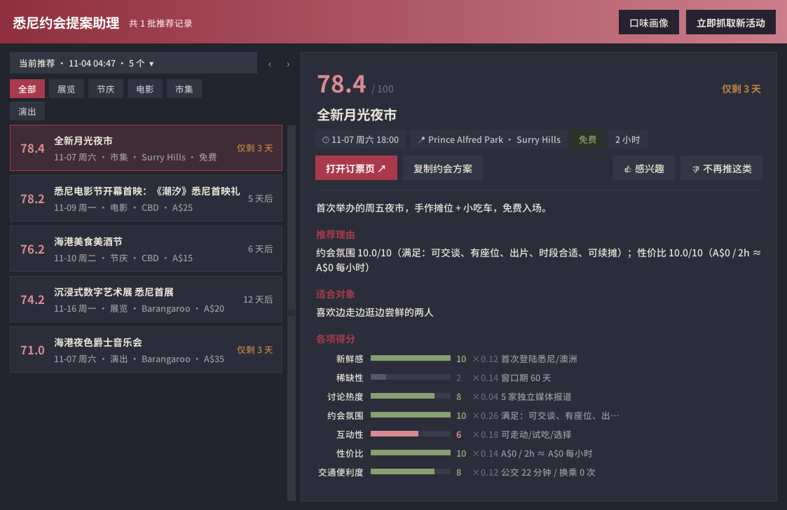
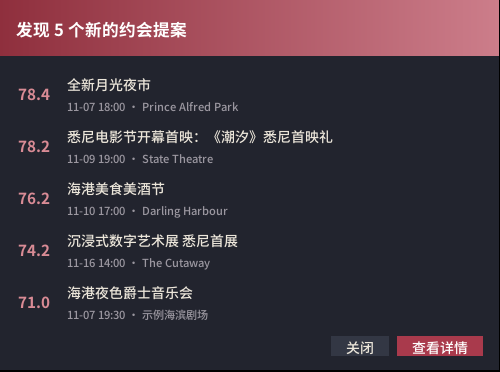

# 悉尼约会助理 · Sydney Date Scout


**每 3 天替你逛一遍悉尼的活动，只把「值得为它安排一次约会」的挑出来，并把怎么约都想好。**

桌面程序 + 定时任务，本地运行。活动按固定的绝对锚点评分，分数跨批次可比；达标的少就少推，一个都没有就直说「本次无推荐」，从不降低标准凑数。每条推荐附带碰头时间、续摊去处、预算拆解、雨天备选和聊天话题。你的 👍/👎 和浏览行为会让它慢慢更懂你。



<p align="center"></p>

### 亮点

- **评分跨批次可比**：7 个维度全部用绝对锚点定义，打分函数只看活动本身，阈值固定 68 分。达标的少就少推，从不凑数。
- **数据驱动的迭代**：每一版改动都有真实运行数据做依据。三个月 201 条推送复盘后上线「约会适配闸门」，用旧数据回放验证，拦下 55% 的不合格推荐。
- **双轨学习**：👍/👎 训练的内容判别模型负责筛选，行为数据驱动的个性化负责排序。两者都刻意设计得慢、可解释，评分标准本身不受影响。
- **从「找活动」到「怎么约」**：每条推荐附带时间线、预算拆解、雨天备选、聊天话题，一键复制就能发给对方。
- **可接任意爬虫**：项目只定义数据契约，并附一段可以直接交给 AI Agent 的对接提示词，用自己选的爬虫工具就能跑通真实数据。
- **零依赖桌面端**：纯标准库 tkinter 自绘界面，中国传统色「胭脂桃夭」主题，可打包为单文件 exe。

---

## 从生活烦恼到落地：一页看懂

这个仓库同时是一份产品作品集。完整复盘见 **[docs/case-study.md](docs/case-study.md)**。

| 阶段 | 关键判断 | 证据 / 结果 |
|---|---|---|
| **生活烦恼** | ① 上班族周末本就有限，却要花大量时间在十几个网站间整理零散信息、做计划；② 想约心仪的人出去，却只会「吃饭看电影」，总被吐槽没情调 | 两类人要的是同一件事：不用从零找，就能拿到靠谱、拿来即用的约会推荐 |
| **需求分析** | 真正要的是「不用我想的时候，告诉我这个值得去，并且想好怎么约」。P0 是主动推送 + 可信筛选；「越用越懂我」排在可信之后 | 非功能需求：分数跨批次可比、宁可少推不凑数、无人值守不出错 |
| **产品设计** | 七维度绝对锚点评分 + 固定 68 分阈值 + 一票否决；推荐附带可执行方案；弹窗主动但不打扰；反馈可撤销 | 不变式测试：同一活动放进强批次、弱批次，分数完全相等 |
| **技术选型** | 本地 Python + 标准库 tkinter + SQLite + 单文件 exe；规则评分而非大模型评分；纯 Python 逻辑回归而非 scikit-learn；**不内置爬虫，只定义数据契约** | 零第三方 GUI 依赖；任何爬虫工具都能接入 |
| **落地迭代** | 用真实运行数据驱动每一版 | 三个月 201 条推送复盘后加「约会适配闸门」，回放验证拦下 55% 的不合格推荐 |

## 快速开始

```bash
git clone https://github.com/MichaelZSH9898/sydney-date-scout.git && cd sydney-date-scout
pip install -r requirements.txt
cp config.example.yaml config.yaml      # 改住址、预算、距离、偏好

python run.py run --dry-run             # 用内置离线样例跑通全链路（不弹窗）
python gui.py                           # 打开桌面程序
python -m unittest discover tests       # 38 个测试
```

克隆下来默认用的是**离线演示数据**（`fixtures/sample_events.yaml`，虚构活动）。要拿到真实推荐，需要接一个数据源，见下一节。定时运行、打包 exe、排障见 [docs/operations.md](docs/operations.md)。

---

## 接入真实数据

本项目**不内置任何站点爬虫**。哪个网站能抓、条款是否允许、用什么工具抓，因城市、因站点、因时间而变，应该由部署的人来决定。项目只规定交货格式：

```
你选的爬虫（Scrapy / Playwright / Crawl4AI / Firecrawl / 官方 API 脚本……）
        │  输出标准 JSON（docs/event.schema.json）
        ▼
  data/inbox/*.jsonl  ──或──  一条打印 JSON 的命令
        │
        ▼
  本项目：去重 → 核验 → 评分 → 学习层 → 约会方案 → 推送
```

### 最小契约

每条活动一个 JSON 对象，必填只有三个字段：

```json
{"title": "海港夜色爵士音乐会", "start": "2026-11-14T19:30", "url": "https://example.com/events/123"}
```

其余字段越全，分数越准。下面这几个字段对评分影响最大，爬虫能拿到就一定要给：

| 字段 | 不给会怎样 |
|---|---|
| `price` | 默认配置下**直接剔除**（价格未知不推）。免费填 `0`，`"From $25"` 这类字符串也能识别 |
| `lat` / `lng` | 交通维度走保守默认分；给了会自动算距离与公交耗时 |
| `dates`（全部场次日期） | 稀缺性走保守默认分。实测同一条活动，有没有 `dates` 相差约 10 分 |
| `end` 或 `duration_hours` | 性价比（每人每小时花费）算不出来 |
| `category` | 用站点自己的分类词即可（Music / Markets…），会自动归一；儿童、社区类会被硬排除 |

约会氛围、互动性这类信号爬虫通常拿不到，项目会按活动类别保守推断。爬虫如果知道得更准，可以放进 `signals` 覆盖推断。完整字段见 [`docs/event.schema.json`](docs/event.schema.json)，参考实现见 [`examples/example_scraper.py`](examples/example_scraper.py)。

### 两种交货方式（在 `sources.yaml` 里选）

- **收件箱 `external_inbox`（默认已开启，推荐）**：爬虫把结果写进 `data/inbox/<源名>.jsonl`，自己单独定时运行。超过 4 天没更新的文件会被忽略并告警，防止爬虫停了却没人发现。
- **命令 `external_command`**：每轮运行一条命令，读取它打印到 stdout 的 JSON。适合抓一次就出结果的轻量脚本。

想直接写 Python 也可以：复制 [`plugins/_example_plugin.py`](plugins/_example_plugin.py)，去掉文件名开头的下划线，启动时会自动加载。

### 自检

```bash
python run.py validate-feed data/inbox/my_source.jsonl
```

逐条告诉你：契约错在哪个字段、被核验剔除的原因、能拿几分、缺了哪些信号。退出码为 0 表示契约全部通过。

### 本机专属配置

私人数据源和开关不必改动受版本控制的 `sources.yaml`。在项目根（exe 版放在 exe 旁边）新建 `sources.local.yaml`，按 `id` 合并：同 id 的条目只覆盖你写的字段，新 id 追加为新数据源。它和 `plugins/` 目录都已加入 `.gitignore`，`git pull` 更新时不会冲突。

```yaml
sources:
  - id: demo_fixtures       # 关掉演示数据
    enabled: false
  - id: my_source           # 新增一个插件数据源（plugins/my_source.py 里注册的类型）
    type: my_source
    enabled: true
```

### 交给你的 AI Agent：对接提示词

把项目克隆到本地后，可以把下面这段话连同尖括号里的信息一起交给你的编程 Agent（Claude Code、Codex、Cursor 等）。它会帮你装好爬虫工具、写好抓取脚本、接上本项目并自检通过：

````text
你是我的部署助手。我已经把 Sydney Date Scout 克隆到当前目录，请帮我接通真实活动数据。

- 我所在的城市：<例如 悉尼>
- 我常住的区或起点经纬度：<例如 Surry Hills，或 -33.88, 151.21>
- 我想看的活动：<例如 演出、展览、市集、美食；不想要的：<…>>
- 我想用的爬虫工具：<工具名或仓库地址；没想好就写「请你推荐并说明理由」>

请按以下步骤进行，每一步做完简要告诉我结果：

1. 先读懂接口，不要改主程序：阅读 README「接入真实数据」一节、docs/event.schema.json、
   examples/example_scraper.py，以及 sources.yaml 里 external_inbox / external_command 两段。
   不要修改 scout/ 目录下的任何代码；新写的脚本放在 scrapers/ 目录（或写成 plugins/ 插件）。

2. 选数据源前先做合规检查，并把结论告诉我：
   - 逐个核实候选网站的服务条款是否允许自动化访问，以及 robots.txt 是否允许目标路径；
   - 有官方 API 的优先用官方 API；
   - 条款禁止自动化访问的、需要登录才能看的页面，一律不接，并告诉我原因；
   - 抓取时标明真实的 User-Agent，请求间隔不少于 1 秒，只抓推荐窗口（未来 21 天）需要的页面。

3. 安装并配置我选定的爬虫工具，写抓取脚本，输出符合契约的 JSONL：
   - 必填 title / start / url；start 是「下一场尚未开始的场次」的时间；
   - 尽量提供 price、lat/lng、dates、end、category、venue、suburb、description、source_name，
     它们直接决定评分（缺 price 会被剔除，缺 dates 和 lat/lng 会走保守默认分）。

4. 二选一接入：
   A. 收件箱（推荐）：脚本输出到 data/inbox/<源名>.jsonl，并为脚本注册一个系统定时任务，
      频率不低于每 3 天一次（Windows 用任务计划程序，macOS/Linux 用 cron）；
   B. 命令：在 sources.local.yaml 里覆盖 external_command：把 command 改成运行脚本的命令，
      并设为 enabled: true（不要直接改 sources.yaml）。

5. 自检循环：反复运行 `python run.py validate-feed <输出文件>` 并修正脚本，直到退出码为 0，
   且大多数记录没有因为「信号缺失」失分。然后在 sources.local.yaml 里把 demo_fixtures 设为 enabled: false，
   运行 `python run.py run --dry-run`，把输出的 JSON 给我看。

6. 如果我不在悉尼：在 config.yaml 里设置 home_coords: [纬度, 经度]，按我的城市改写 area_anchors
   （碰头与续摊地点），并列出项目里还有哪些悉尼专属内容需要我手动确认。

7. 最后给我一份简短的交接说明：接了哪些数据源及各自的条款结论、新增了哪些文件、
   定时任务怎么查看和取消、以后网站改版导致抓取失败时去哪里看日志（data/out/scout.log）。
````

> **合规提醒**：抓取公开网页的合法性取决于所在地法律和目标网站的条款，部署者需要自行判断并承担责任。本项目只消费你交给它的数据，不会替你访问任何网站。

---

## 架构

```
外部数据（收件箱 / 命令 / 插件）+ 离线样例
          │
          ▼
  去重 dedupe ──► 核验 verify ──► 评分 scoring ──► 阈值筛选 ──► 学习层 ──► 约会方案 plan
  标题+时间+场地    时间/价格/距离     rubric.yaml      固定 68 分     内容判别 +     时间线/预算/
  合并来源证据      约会适配闸门       7 维度绝对锚点   + 一票否决     个性化排序     备选/话题
          │                                                                         │
          └──────────────────── SQLite：批次 / 历史 / 反馈 / 行为 ───────────────────┤
                                                                                    ▼
                                                     桌面弹窗 notifier · 桌面程序 gui.py
```

| 模块 | 职责 |
|---|---|
| `sources.yaml` | 声明式数据源清单。新增一个源就是加一段 YAML |
| `scout/collectors/external.py` | 外部数据契约：解析、校验、按类别画像推断缺失信号 |
| `scout/collectors/` | 采集器注册表；另有 `rss / ics / json / astro / fixtures`，以及 `plugins/` 自动加载 |
| `scout/geo.py` | 起点坐标、距离、公交耗时估算 |
| `scout/dedupe.py` · `verify.py` | 跨源去重；核验与「约会适配闸门」（儿童/社区/志愿者类直接剔除） |
| `scout/scoring.py` + `rubric.yaml` | 7 维度打分。函数签名只接受单个活动，结构上无法相对化 |
| `scout/datefit.py` · `personalize.py` | 学习层：👍/👎 训练的内容判别模型；行为驱动的类别亲和度（只调批内排序） |
| `scout/plan.py` | 约会方案；可选调用大模型润色文案，失败时静默回退 |
| `scout/store.py` | SQLite：批次、跨批次去重、推送历史、反馈、行为、运行间隔守卫 |
| `gui.py` · `scout/notifier.py` · `scout/theme.py` | 桌面程序与弹窗；中国传统色「胭脂桃夭」主题集中在 theme.py |

## 评分规则（rubric v1.2.0）

总分 = Σ(维度分 × 权重) × 10，满分 100，**推荐阈值固定 68 分**。

| 维度 | 权重 | | 维度 | 权重 |
|---|---|---|---|---|
| 约会氛围 | 0.26 | | 新鲜感 | 0.12 |
| 互动性 | 0.18 | | 交通便利度 | 0.12 |
| 稀缺性 | 0.14 | | 讨论热度 | 0.04 |
| 性价比 | 0.14 | | | |

**一票否决**：约会氛围 <5、交通 <4、性价比 <3，或信息完整度 <70%。**降权**：单人向活动 ×0.85、社区场地 ×0.8。锚点全表与每次调权的理由写在 [`rubric.yaml`](rubric.yaml) 里；`python run.py explain --uid <uid>` 可以打印任意一条活动的逐维度评分依据。

## 文档

| 文档 | 内容 |
|---|---|
| [docs/case-study.md](docs/case-study.md) | 产品复盘：烦恼 → 需求 → 设计 → 选型 → 迭代 |
| [docs/operations.md](docs/operations.md) | 安装、exe 打包、定时运行、配置项、常用命令、已知边界 |
| [docs/event.schema.json](docs/event.schema.json) | 外部数据契约 |
| [CHANGELOG.md](CHANGELOG.md) | 每个版本改了什么、为什么改 |

## 关于开发方式

产品定义、需求取舍、视觉定调与验收由作者完成，代码实现大量借助 AI 编程助手（Claude）协作完成，提交记录里的协作者署名如实保留。

## 许可

[MIT](LICENSE) © 2026 Shuhan Zhang。离线样例中的活动均为虚构；示例里出现的场馆名与品牌名仅用于说明，与本项目无关联。
