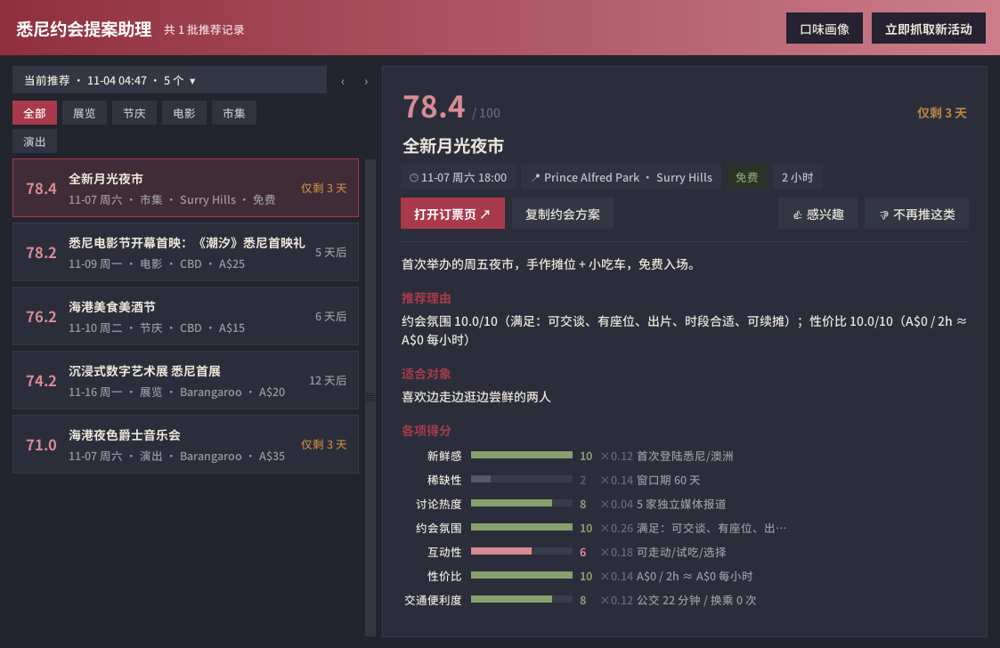

# 案例复盘：从「周末去哪约会」到一个会自己学习的推荐助手

> 这是一份产品复盘，按 **生活烦恼 → 需求分析 → 产品设计 → 技术选型 → 落地与迭代** 的顺序展开。
> 每一节都尽量写清两件事：当时做了什么判断，以及后来真实数据证明这个判断对不对。
> 文中数字均来自项目自己的运行记录与测试，不是估算。

---

## 1. 生活烦恼

这个工具起源于两个非常日常的场景。

### 场景一：周末本来就短，还要花半天「做功课」

对上班族来说，一周真正属于自己的只有周末那一两天。想找点有意思的事做，却要先在十几个地方来回翻：市政活动库、各场馆官网、票务平台、生活方式媒体、团购站……

- **信息零散**：没有一个地方同时告诉你「什么时候、多少钱、离我多远、适不适合两个人」；
- **无法比较**：这周的露天电影和下周的周末市集哪个更值得？每个页面的写法和标准都不一样；
- **窗口很短**：真正好的活动往往只办一两场，等想起来去看，已经售罄或结束了；
- **计划费心**：找到活动只是第一步，在哪碰头、结束后去哪、预算多少，还得再规划一遍。

结果是，本该用来休息的时间，有相当一部分花在了「整理信息、做计划」上，而且最后选的是不是好活动，很看运气。

### 场景二：「约你出去玩」，却总被吐槽没情调

另一类用户的痛点更具体：想约心仪的人出去，却不知道去哪。翻来覆去还是「吃饭、看电影、逛商场」老三样，于是被吐槽「没情调」。直男邀请女神的场景里，这几乎是固定剧情。

他们缺的不是诚意，而是**一份靠谱的、拿来就能用的推荐**：去哪里、为什么适合两个人、几点在哪碰头、结束后去哪续摊、甚至路上可以聊什么。

### 两个场景的共同点

两类人要的是同一件事：**不用自己从零开始找，也能稳定地拿到「值得为它安排一次约会」的去处，并且把怎么约都想好。**这就是本产品的出发点。

## 2. 需求分析

### 2.1 真正要解决的是什么

把烦恼拆开，核心诉求其实只有一句：**在我不需要主动去想的时候，告诉我「这个值得为它安排一次约会」，并且把怎么约都想好。**

由此得到四个需求，以及它们的优先级判断：

| 需求 | 用户原话式描述 | 优先级 | 理由 |
|---|---|---|---|
| 主动推送 | 「别让我每次都去搜」 | P0 | 痛点的根源是「每次从零开始」，被动的搜索工具解决不了 |
| 可信的筛选 | 「推给我的就得是好的」 | P0 | 推送类产品的生命线：坏推荐的成本是不对称的，一条幼儿故事会就能毁掉整批推荐的可信度 |
| 可执行的方案 | 「顺便告诉我怎么约」 | P1 | 活动只是约会的一部分，时间线、预算、备选才让推荐真正可执行 |
| 越用越懂我 | 「我不喜欢的别再推」 | P2 | 有价值，但必须建立在前两条已经可信的基础上 |

### 2.2 关键的非功能需求

- **分数要跨批次可比。** 「这次 80 分」和「上个月 80 分」必须是同一个意思，否则用户无法建立对分数的信任。这条直接决定了评分算法的形态（见 3.2）。
- **宁可少推，不可凑数。** 某一轮没有好活动，就明确说「本次无推荐」，而不是降低标准推几条凑数。
- **无人值守也不能出错。** 电脑关机两个月再开机，不能一次弹出一堆窗口；夜里跑完没人关窗，也不能让下一轮白跑。

### 2.3 刻意不做的事

- 不做社交与匹配：只服务「已经有约会对象，想找好去处」这个场景。
- 不做网页或小程序：单用户、本地运行，省掉账号、服务器和隐私问题。
- 不让大模型打分：大模型的输出随提示词和版本漂移，与「分数跨批次可比」冲突。大模型只作为可选项，用来润色方案文案。

## 3. 产品设计

### 3.1 一条推荐是怎么产生的

```
采集 ──► 去重 ──► 核验 ──► 评分 ──► 阈值筛选 ──► 学习层调整 ──► 约会方案 ──► 弹窗 / 桌面程序
多源      同一活动    时间/价格/     7 维度     固定 68 分       内容判别 +       时间线/预算/
          合并证据    距离/适配闸门  绝对锚点   + 一票否决       个性化排序       备选/话题
```

### 3.2 评分：用「绝对锚点」换取可比性

七个维度，每个维度 0–10 分，全部用**绝对锚点**定义（完整表见 [`rubric.yaml`](../rubric.yaml)）：

| 维度 | 权重 | 锚点举例 |
|---|---|---|
| 约会氛围 | 0.26 | 可交谈 / 有座位 / 出片 / 时段合适 / 可续摊，每项 2 分 |
| 互动性 | 0.18 | 双人协作 10 · 动手 8 · 边走边逛 6 · 共同观看可交流 4 · 需安静 2 |
| 稀缺性 | 0.14 | 窗口 ≤1 天 10 · ≤3 天 8 · ≤14 天 6 · >120 天 0 |
| 性价比 | 0.14 | 免费 10 · ≤A$10/人/小时 9 · … · >A$100 0 |
| 新鲜感 | 0.12 | 首次登陆悉尼 10 · 首届 8 · 年度沿用 4 · 常设无更新 0 |
| 交通便利度 | 0.12 | ≤15 分钟且不换乘 10 · … · >75 分钟 0 |
| 讨论热度 | 0.04 | 独立来源报道数 ≥8 家 10 · 1 家 2 |

三条设计约束保证可比性：

1. 打分函数的入参只有「单个活动 + 评分表」，没有同批次的其他活动——相对排名在代码结构上不可能发生；
2. 阈值固定 68 分，改动评分表必须升版本号，历史推送跨版本时会明确告警；
3. 有测试专门把同一活动放进「强批次」和「弱批次」，断言分数完全相等。

再加两道保险：**一票否决**（约会氛围 <5、交通 <4、性价比 <3、信息完整度 <70%，总分再高也不推）和**降权**（单人向活动 ×0.85、社区场地 ×0.8）。

### 3.3 方案：把「找到活动」延伸到「怎么约」

每条推荐附带碰头时间与地点、活动后的续摊去处、人均预算拆解、雨天备选、两三个聊天话题，以及「复制约会方案」按钮：一键生成可以直接发给对方的文字。

### 3.4 交互：主动但不打扰

| 设计 | 解决的问题 |
|---|---|
| 每 3 天一轮，有新推荐才弹一个窗 | 主动推送，又不变成骚扰 |
| 四层防重弹（单窗口 / 单批上限 / 任务不叠加 / 错过只补一次） | 关机 60 天再开机 = 补跑 1 次 = 1 个弹窗 |
| 桌面程序：卡片列表 + 维度条形图 + 倒计时 | 一眼看懂「为什么推它」「还剩几天」 |
| 👍/👎 可撤销 | 不可撤销的永久拉黑会让人不敢点，反馈闭环就死了 |
| 「口味画像」面板 | 让用户看见学习系统在成长，才有持续反馈的动力 |



### 3.5 视觉：给恋爱工具找对气质

视觉方向经历过两次被否决，这个过程本身就是一次需求澄清：

1. 初版陶土橙 + 系统默认控件 → 被否决：恋爱辅助工具用土黄色和 WinXP 感控件，「性缩力拉满」；
2. 参考 Tinder / Hinge 的玫瑰→紫罗兰渐变 → 被否决：媚俗，太像应用商店里的模板；
3. 最终定调中国传统色「胭脂桃夭」：玄青/黛为底，胭脂为主色，桃花只做高光。取意「桃之夭夭，灼灼其华」。浪漫放在意象和层次里，不放在饱和度里，任何性别的用户看着都舒服。

工程上的回报是：v1.4.0 把所有颜色收进了 [`scout/theme.py`](../scout/theme.py)，后面两次整套换肤都只改了这一个文件。

## 4. 技术选型

| 决策点 | 选了什么 | 放弃了什么 | 为什么 |
|---|---|---|---|
| 形态 | 本地桌面程序 + 系统定时任务 | 网页 / 小程序 / 常驻服务 | 单用户场景不需要服务器与账号；系统定时任务关机也能补跑 |
| 语言 | Python | — | 采集、数据处理、轻量机器学习一套语言搞定 |
| 界面 | 标准库 tkinter + 自绘扁平组件 | ttkbootstrap、CustomTkinter、Electron | 坚持「零第三方 GUI 依赖、单文件 exe」；参考 Sun-Valley 主题的思路自绘按钮、卡片、toast，观感现代、依赖仍为零 |
| 存储 | SQLite | JSON 文件 | 跨批次去重、推送历史、行为日志都需要查询；SQLite 零运维 |
| 评分 | 规则评分表（YAML） | 大模型打分 | 可解释、可回放、跨批次可比 |
| 学习 | 纯 Python 逻辑回归 + 特征哈希 | scikit-learn | 标签只有几十到几百条，简单模型足够；零依赖，exe 体积不变；训练结果确定，可复现 |
| 分发 | PyInstaller 单文件 exe | 要求用户装 Python | 非技术用户双击即用 |
| 数据接入 | 声明式源清单 + 外部爬虫契约 | 内置各站爬虫 | 见下 |

### 数据源：被现实教育最多的一环

最初的设想是「接 17 个站点的 RSS」。2026 年 8 月逐个实测：

- **15 个 404 或域名不通**：这些站从来没提供过 RSS，地址是照常见路径猜的；
- **2 个能用但没用**：资讯流不是活动流，只有文章发布时间，没有活动开始时间。接进来 110 条，可用 0 条；
- 还查了这些站有没有埋 JSON-LD `Event` 结构化数据：一个都没有。

唯一能同时给出真实开始时间、价格、场馆经纬度的，是悉尼市政府的官方活动库。于是给它写了专用适配器，跑了三个月。但准备开源时重读它的使用条款，发现其中明确禁止对网站使用自动化脚本工具。

这促成了 v1.5.0 的架构决定：**本项目不再内置任何站点爬虫，只定义交货格式**。

```
你选的爬虫（任何语言、任何工具） ──► 标准 JSON（docs/event.schema.json） ──► 本项目
```

- 哪个站能抓、条款是否允许，因城市、因站点、因时间而变，应该由部署者在部署时判断，而不是由仓库替所有人决定；
- 开源爬虫工具（Scrapy、Playwright、Crawl4AI、Firecrawl……）迭代得比任何专用适配器都快；
- 契约只要求 `title / start / url` 三个字段，缺的约会信号按类别画像保守推断；`validate-feed` 命令逐条告诉对接方卡在哪。这让「让自己的 AI Agent 帮忙接数据」成为一条可靠的路径（提示词见 [README](../README.md#接入真实数据)）。

## 5. 落地与迭代

### 时间线

| 版本 | 日期 | 做了什么 | 触发它的证据 |
|---|---|---|---|
| v1.0 | 2026-07 | 全链路 MVP：采集→评分→方案→邮件 | — |
| v1.1 | 2026-08 | 接入首个真实源并重配权重；桌面弹窗、exe 打包、定时任务 | 接入真实源后最高分只有 60.8，68 分线永远触发不了 |
| v1.2 | 2026-10 | 约会适配闸门、系列防重复、品类多样性、反馈闭环 | 三个月 22 批 201 条推送，近八成是社区课程和儿童活动 |
| v1.3 | 2026-10 | 双轨学习：内容判别模型 + 行为个性化 | 规则只能挡住明显的坏推荐，「好不好」需要从反馈里学 |
| v1.4 | 2026-10 | UI 专项改版 + 中国传统色主题 | 自评「交互很差劲」 |
| v1.5 | 2026-11 | 外部爬虫接口，准备开源 | 唯一真实源的条款禁止自动化访问 |

### 三次最有价值的复盘

**① 「标准太严」其实是「测不出来」（v1.1）**
接入第一个真实源、实测 42 个活动后，最高分只有 60.8。直觉是降阈值，但拆开看：「讨论热度」恒为 2 分（只接了一个源，独立来源数永远是 1），「新鲜感」最高 4 分（官方数据不标注「首届」）。两个维度合计 30% 的权重被**数据可得性**锁死了，和活动好坏无关。解法是把权重移到能被真实测量的维度上，阈值一分不动。68 分仍然意味着「值得为它安排一次约会」。

**② 七个维度没有一个在问「这像约会吗」（v1.2）**
跑了三个月后回看 201 条推送：免费、动手、周末举办的社区课程和儿童假期营，恰好是旧评分表的满分模板。修复方案是加一道「约会适配闸门」，并用旧数据回放验证：**201 条里有 55% 会被新规则拦下**，其中适配闸门拦 9%、社区场地降权拦 26%、系列级防重复拦 20%。推送量明显变少，这是设计目标：三条真值得去的，好过十条凑数的。

**③ 学习系统要「慢」，而且要被看见（v1.3–v1.4）**
- 内容判别模型用 👍/👎 训练，只作用在筛选层，评分表一个字节不动。用 38 条真实标签做 5 折交叉验证，准确率 62%：方向正确，但还嫩。所以默认阈值故意放宽，只剪掉最明显的差条目；
- 行为个性化只调同一批次内的排序，有平滑伪计数和 ±4 分的加成上限：刻意慢、可解释；
- 两者在 v1.4 都被做成了「口味画像」面板。看得见成长，用户才愿意持续反馈。

### 工程上踩过的坑

- **弹窗阻塞导致运行不被记录。** 弹窗不关，`mainloop()` 就一直阻塞；早期版本把「记录本次运行」放在弹窗之后，于是夜里跑完没人关窗，下一轮会重复采集。数据库里留下的证据是：批次表有记录，运行表没有。
- **中文路径让 .bat 静默失败。** cmd.exe 按当前控制台代码页解析 .bat，中文路径会被截断，`REM` 注释被当成命令执行；症状是退出码 1、连日志都没有。最后改成让定时任务直接调用 `pythonw.exe`。
- **exe 与源码版的数据目录不同。** 打包后数据跟着 exe 走，双击 exe「没有历史推荐」就是这个原因。

### 质量

37 个自动化测试，覆盖评分不变式（跨批次可比）、约会适配闸门、学习层，以及外部爬虫契约的解析、推断与两种交货方式。

## 6. 还没做 / 下一步

- **交通耗时是估算**（直线距离 × 经验系数），接入 Transport for NSW Trip Planner API 后应替换；
- **城市配置包**：目前郊区坐标表、续摊地点、话题文案仍是悉尼专属，可以收拢成一个可切换的城市配置；
- **冷启动模型**：标签攒过百条后冻结内容判别模型，随仓库分发给新用户；
- **跨源去重恢复「讨论热度」**：接入第二个真实源后，这个维度会重新有效，届时把权重调回去并升版本号。
